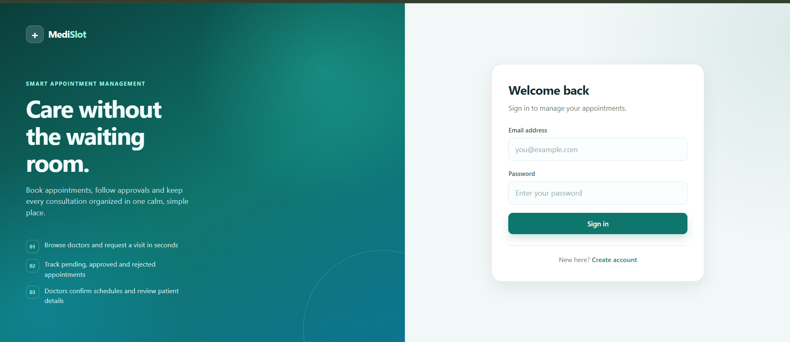
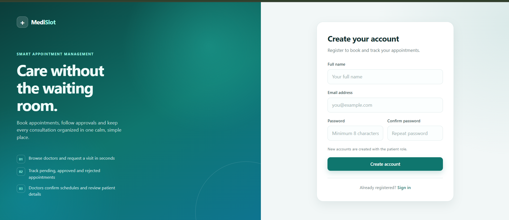
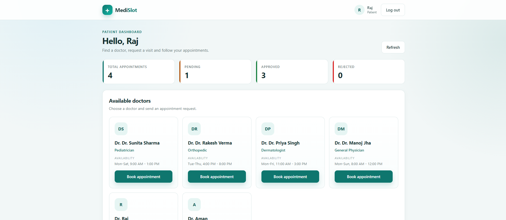
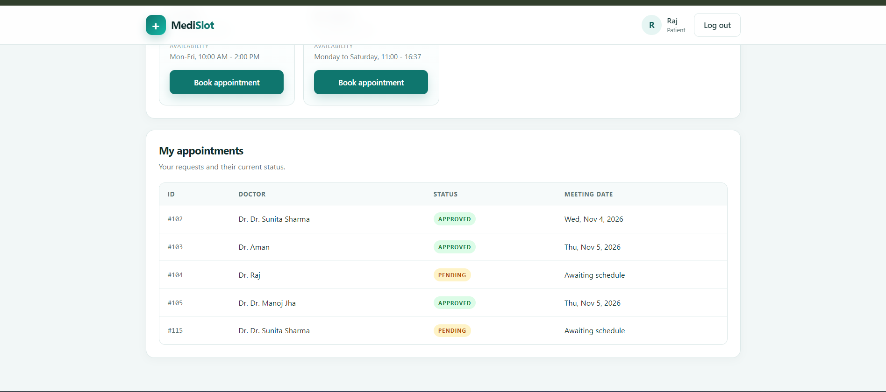
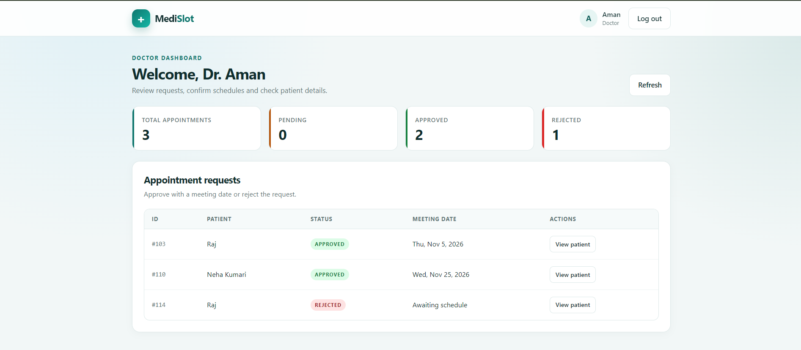

# MediSlot

**A full-stack hospital appointment and queue management system built with Spring Boot and React.**

MediSlot lets patients find doctors and request appointments, while doctors review those requests,
set meeting dates, approve or reject visits, and view patient details. The application uses JWT
authentication and role-based access control to keep patient and doctor workflows separate.

## Screenshots

| Login | Register |
| ----- | -------- |
|  |  |

| Patient dashboard | Patient appointments |
| ----------------- | -------------------- |
|  |  |

| Doctor dashboard |
| ---------------- |
|  |

## Project Summary

MediSlot is a complete three-tier application:

- **Frontend:** a React single-page application with protected routes, authentication state, and
  separate patient and doctor dashboards.
- **Backend:** a stateless Spring Boot REST API secured with JWT, BCrypt password hashing, and
  role-based authorization.
- **Database:** a MySQL schema modeled with JPA/Hibernate for users, patients, doctors, and
  appointments.

## Resume Highlights

- Built a full-stack appointment management system using **Spring Boot, React, and MySQL**.
- Designed and implemented **13 REST endpoints** across authentication, patient, and doctor
  controllers.
- Added **JWT authentication**, BCrypt password hashing, and role-based access control for
  `PATIENT` and `DOCTOR` users.
- Developed a responsive React SPA with protected routes, an Axios API layer, and centralized
  error handling.
- Modeled relational data with **JPA/Hibernate** and used DTOs to keep API responses separate from
  database entities.
- Configured CORS, stateless security, request validation, and global exception handling.

## Features

### For patients

- Register and sign in securely
- Complete a patient profile with age and mobile number
- Browse available doctors by specialization and availability
- Request an appointment with a doctor
- Track pending, approved, and rejected appointments

### For doctors

- Complete a doctor profile with specialization and availability
- View all appointment requests
- Approve a request with a meeting date
- Reject a request
- View patient details for a specific appointment

### Platform

- JWT-based authentication with a one-hour token expiry
- Role-based route protection on the frontend and backend
- Stateless Spring Security configuration
- Request validation and centralized API error handling
- Responsive user interface for desktop and mobile
- CORS configured for the local Vite development server

## Tech Stack

| Layer      | Technology                                                    |
| ---------- | ------------------------------------------------------------- |
| Backend    | Java 17, Spring Boot, Spring Security, Spring Data JPA, Maven |
| Authentication | JWT (jjwt 0.12.6), BCrypt password hashing               |
| Database   | MySQL                                                         |
| Frontend   | React 19, Vite, React Router, Axios                           |
| Tooling    | Lombok, Bean Validation, Oxlint                               |

## Architecture

```text
┌─────────────────────────────┐
│        React Frontend       │
│  React Router + Axios       │
│  Auth context + dashboards  │
└──────────────┬──────────────┘
               │ HTTP + JWT
               ▼
┌─────────────────────────────┐
│      Spring Boot Backend    │
│  Controllers → Services     │
│  Spring Security + JWT      │
│  DTOs + exception handling  │
└──────────────┬──────────────┘
               │ JPA / Hibernate
               ▼
┌─────────────────────────────┐
│          MySQL              │
│  User, Patient, Doctor,     │
│  Appointment                │
└─────────────────────────────┘
```

## Project Structure

```text
MediSlot/
├── backend/                  Spring Boot REST API
│   ├── src/main/java/com/medislot/
│   │   ├── config/           Security and CORS configuration
│   │   ├── controller/       Auth, patient and doctor endpoints
│   │   ├── dto/              Request and response models
│   │   ├── entity/           JPA entities
│   │   ├── enums/            Roles and appointment statuses
│   │   ├── exception/        Global exception handling
│   │   ├── repository/       Spring Data repositories
│   │   ├── security/         JWT filter and token service
│   │   └── service/          Business logic
│   ├── src/main/resources/application.properties
│   └── pom.xml
├── frontend/                 React single-page application
│   ├── src/api/              Axios client and error helpers
│   ├── src/components/       Shared UI components
│   ├── src/context/          Authentication context
│   ├── src/pages/            Login, register and dashboards
│   ├── src/utils/            Date helpers
│   ├── .env                  Frontend API URL
│   └── vite.config.js
├── screenshots/              Application screenshots used in this README
└── README.md
```

Backend Maven coordinates: `com.medislot:MediSlot`. Frontend package: `medislot-frontend`.

## How It Works

1. A new user registers and is assigned the `PATIENT` role.
2. After signing in, the JWT is stored in the browser and attached to every API request.
3. A patient completes their profile, chooses a doctor, and creates an appointment.
4. The appointment starts with the `PENDING` status.
5. The doctor approves it with a meeting date or rejects it.
6. The patient sees the updated status on their dashboard.

## Getting Started

### Prerequisites

- Java 17 or newer
- Node.js 18 or newer
- MySQL 8 or newer
- No separate Maven installation is needed; the Maven wrapper is included

### 1. Create the database

```sql
CREATE DATABASE Hospital;
```

Create your local configuration from the example file:

```bash
cp backend/src/main/resources/application.properties.example
```

On Windows PowerShell:

```powershell
Copy-Item backend\src\main\resources\application.properties.example
```

Update the MySQL username and password in the new file. It is git-ignored, so your local
credentials are not committed. Hibernate creates and updates the tables automatically on startup.

### 2. Start the backend

From the project root:

```bash
cd backend
./mvnw spring-boot:run
```

On Windows PowerShell:

```powershell
cd backend
.\mvnw.cmd spring-boot:run
```

The API runs at `http://localhost:8080`.

### 3. Start the frontend

Open a second terminal:

```bash
cd frontend
npm install
npm run dev
```

The app runs at `http://localhost:5173`.

The frontend reads the API URL from `frontend/.env`:

```env
VITE_API_URL=http://localhost:8080
```

The backend CORS configuration allows requests from `http://localhost:5173`, so keep the Vite
server on that port.

### Creating a doctor account

Registration through the UI always creates a patient account. To test the doctor dashboard:

1. Register a normal account through the app.
2. Update the role directly in MySQL:

   ```sql
   UPDATE `user` SET role = 'DOCTOR' WHERE email = 'doctor@example.com';
   ```

3. Sign out and sign in again so the new role is included in the token.
4. Complete the doctor profile from the dashboard.

## API Overview

Base URL: `http://localhost:8080`

Protected endpoints require this header:

```http
Authorization: Bearer <token>
```

### Authentication

| Method | Endpoint         | Access | Description                    |
| ------ | ---------------- | ------ | ------------------------------ |
| POST   | `/auth/register` | Public | Register a new patient account |
| POST   | `/auth/login`    | Public | Sign in and receive a JWT      |

### Patient endpoints

| Method | Endpoint                           | Description                         |
| ------ | ---------------------------------- | ----------------------------------- |
| GET    | `/patient/is-patient`              | Check whether a profile exists      |
| POST   | `/patient/patients`                | Create the patient profile          |
| GET    | `/patient/doctor`                  | List available doctors              |
| POST   | `/patient/appointments/{doctorId}` | Request an appointment              |
| GET    | `/patient/appointments/me`         | List the signed-in patient's visits |

### Doctor endpoints

| Method | Endpoint                             | Description                          |
| ------ | ------------------------------------ | ------------------------------------ |
| GET    | `/doctor/is-doctor`                  | Check whether a profile exists       |
| POST   | `/doctor/doctors`                    | Create the doctor profile            |
| GET    | `/doctor/appointments/me`            | List the signed-in doctor's requests |
| GET    | `/doctor/appointments/{id}/patient`  | View patient details                 |
| PUT    | `/doctor/appointments/{id}/approval` | Approve with a meeting date          |
| PUT    | `/doctor/appointments/{id}/rejection`| Reject an appointment                |

Approval request body:

```json
{
  "meetingTime": "2026-11-05"
}
```

### Appointment statuses

`PENDING` → waiting for the doctor  
`APPROVED` → confirmed with a meeting date  
`REJECTED` → declined by the doctor

## Data Model

- A `User` has one optional `Patient` profile and one optional `Doctor` profile.
- A `Patient` can have many `Appointment` records.
- A `Doctor` can have many `Appointment` records.
- Each appointment belongs to exactly one patient and one doctor.
- Roles are stored as an enum: `PATIENT`, `DOCTOR`, and `ADMIN`.
- Appointment status is stored as an enum: `PENDING`, `APPROVED`, and `REJECTED`.

## Technical Decisions

- **JWT over sessions:** the API is stateless, which keeps authentication simple and makes the
  frontend and backend independently deployable.
- **DTOs for responses:** login, doctor lists, patient details, and appointment responses use DTOs
  instead of exposing entities directly.
- **Role-based access:** Spring Security protects `/patient/**` and `/doctor/**` routes, while the
  React app uses protected routes to prevent users from opening the wrong dashboard.
- **Profile completion flow:** the backend supports users without a patient or doctor profile, so
  the frontend checks profile existence after login and shows a setup form when needed.
- **Centralized errors:** the backend returns readable messages for invalid credentials and missing
  resources, and the frontend displays them through a shared error helper.

## Challenges and Solutions

**Creating doctor accounts without an admin module**  
The registration endpoint only creates patients. For this version, a doctor account is created by
registering normally and updating the role in MySQL, then completing the doctor profile from the
dashboard. A full admin approval flow is listed as a future improvement.

**Keeping authentication state in sync**  
Expired or invalid tokens would leave the UI in a signed-in state. An Axios response interceptor
clears the stored token on `401` responses and the auth context reacts by redirecting the user to
the login page.

**CORS and local development ports**  
The backend allows `http://localhost:5173`, so the Vite server is configured with a fixed port.
This avoids the confusing CORS errors that appear when Vite picks a different port.

**Separating patient and doctor workflows**  
Both roles share the same authentication system but need different dashboards and API access.
This is handled with backend role checks, frontend protected routes, and conditional profile setup
forms.

## Configuration Notes

- JWT tokens expire after one hour.
- The JWT secret and database credentials are configured in
  `backend/src/main/resources/application.properties`.
- Replace the sample JWT secret and database credentials before deploying anywhere.
- Hibernate is set to `ddl-auto=update`, which is convenient for development but should be
  replaced with migrations in a production setup.

## Available Scripts

| Location   | Command           | Purpose                      |
| ---------- | ----------------- | ---------------------------- |
| `frontend` | `npm run dev`     | Start the Vite dev server    |
| `frontend` | `npm run build`   | Create a production build    |
| `frontend` | `npm run preview` | Preview the production build |
| `frontend` | `npm run lint`    | Run Oxlint                   |

## What I Learned

- Connecting a React SPA to a secured Spring Boot API
- Implementing JWT authentication and role-based authorization end to end
- Modeling relational data with JPA and Hibernate
- Managing authentication state and protected routes in React
- Debugging CORS, token expiry, and role-based access issues
- Structuring a project into clear backend and frontend layers

## Known Limitations

- Doctor accounts must be created manually by changing the role in the database.
- There is no email or SMS notification system.
- Appointment lists are not paginated.
- The doctor list does not support search or filtering yet.
- There is no admin dashboard.
- Automated test coverage is limited to the default backend test.

## Possible Improvements

- Add a doctor registration and admin approval flow
- Add live queue tracking and estimated waiting times
- Integrate email or SMS reminders
- Add calendar-based scheduling and availability slots
- Add search, filtering, and pagination
- Add integration and end-to-end tests
- Containerize the backend and frontend with Docker

## Author

**Aman Kumar**

- GitHub: `https://github.com/amankumar-codes`
- LinkedIn: `https://www.linkedin.com/in/amankumar-codes/`
- Email: `aman.kumar.backend@gmail.com`
